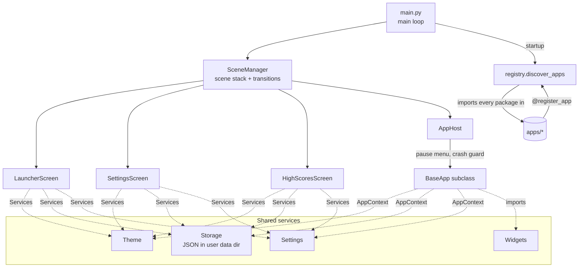

# Arcade

An all-in-one desktop arcade of small games and tools, built with Python and [pygame-ce](https://pyga.me/).
One window, one main loop, a launcher to pick from, and a plugin system that makes adding a new app
as simple as dropping a folder into `apps/`.


## Features

- **Plugin architecture**: apps are discovered automatically at startup. Adding one never touches the launcher.
- **Launcher**: card grid with category tabs (All / Games / Tools), search-as-you-type and full keyboard navigation.
- **Framework-level pause menu** (Esc → Resume / Restart / Back to menu). Games also pause automatically when the window loses focus.
- **Crash isolation**: if an app throws, the error is logged and a friendly dialog brings you back to the launcher.
- **Global High Scores** screen, generated from every app that tracks scores (including per-difficulty bests).
- **Settings**: dark/light theme, window size presets, fullscreen (F11), FPS counter, animations.
- **Modern look**: flat design, rounded corners, soft shadows, hover/press states and screen transitions; all graphics are drawn in code.
- **Quality**: type hints throughout, `mypy --strict`, `ruff`, 300+ pytest tests, GitHub Actions CI.

### Apps

16 apps (13 games and 3 tools), each one a self-contained package in `apps/`.
The arcade-genre games (Stackfall, Brick Blitz, Paddle Duel, Skyhop, Star Siege, Four in a Row,
Five Letters) are original takes on classic genres, with their own names, art and tuning.

**Games**

| App | Highlights |
|-----|------------|
| **2048** | Animated slides, merges and spawns; keyboard or mouse swipe; resume an unfinished game |
| **Brick Blitz** | Four hand-made layouts, multi-hit and steel bricks, paddle-angle control, keyboard or mouse, sub-stepped collisions |
| **Five Letters** | Word guessing: 800 hand-picked answers, 8.5k valid guesses, duplicate-aware scoring, hard mode, stats and best streak |
| **Four in a Row** | Negamax with alpha-beta (up to 7 moves deep) on a background thread, 3 levels, falling-disc animation |
| **Memory Match** | 3 board sizes, 12 vector symbols, flip animations, moves counter, best time per size |
| **Minesweeper** | 3 board sizes, first click always safe (and opens an area), flags, chording, best time per size |
| **Paddle Duel** | 2 players on one keyboard, or a CPU that predicts bounces (3 levels, simulation-tested); spin; longest-rally record |
| **Skyhop** | One-button flyer through neon gates, parallax skyline, capped difficulty ramp |
| **Snake** | Queued turns, speeds up as you eat, walls or wrap-around, smooth interpolated movement |
| **Stackfall** | Falling blocks: 7-bag randomizer, wall kicks, lock delay, ghost piece, hold, 5-piece preview |
| **Star Siege** | Fixed-screen shooter: formations speed up as they thin out, eroding shields, lives, waves |
| **Sudoku** | Unique-solution generator (Easy/Medium/Hard), pencil notes, conflict highlighting, check, undo, resume |
| **Tic-tac-toe** | Unbeatable minimax (exhaustively tested) or an easy mode; win/draw/loss record |

**Tools**

| App | Highlights |
|-----|------------|
| **Calculator** | Hand-written recursive-descent parser (no `eval`), precedence, parentheses, powers, exact decimals, history |
| **Focus Timer** | Pomodoro cycles and a lap stopwatch; wall-clock based so it keeps running while you play; visual alerts (no sound) |
| **Unit Converter** | 8 categories with exact `Decimal` factors, every unit shown at once |

## Screenshots

> _Screenshots and GIFs coming soon._

| Launcher | Sudoku | Star Siege |
|----------|--------|------------|
|  |  |  |

## Getting started

Requires **Python 3.11+**.

```bash
git clone https://github.com/OWNER/arcade-app.git
cd arcade-app
python -m venv .venv
source .venv/bin/activate          # Windows: .venv\Scripts\activate
pip install -r requirements.txt
python main.py
```

### Controls

| Where      | Keys |
|------------|------|
| Everywhere | **Esc** pause menu / back · **F11** fullscreen |
| Launcher   | **Arrows** select · **Enter** open · **Tab** switch category · just start typing to search |
| 2048       | **Arrows/WASD** or drag with the mouse · **N** new |
| Brick Blitz | **←/→** or mouse to move · **Space** / click to launch |
| Calculator | Type the expression · **Enter** evaluate · **Backspace** delete · **Del** clear · **^** power |
| Five Letters | Type letters · **Enter** submit · **Backspace** delete (or use the on-screen keyboard) |
| Focus Timer | **Space** start/pause · **R** reset · **S** skip · **L** lap · **Tab** switch |
| Four in a Row | Click a column or **1–7** · **←/→** + **Enter** · **N** new round |
| Memory Match | Click a card, or **arrows** + **Space** · **N** new game |
| Minesweeper | **Left click** reveal · **Right click** flag · click a number to chord · **Arrows** + **Space** / **F** · **N** new |
| Paddle Duel | Left **W/S** · right **↑/↓** (vs CPU: either set) |
| Skyhop     | **Space**, **↑** or click to hop |
| Snake      | **Arrows/WASD** steer · **P** pause |
| Stackfall  | **←/→** move · **↓** soft drop · **↑/X** rotate · **Z** rotate back · **Space** hard drop · **C** hold · **P** pause |
| Star Siege | **←/→** or **A/D** move · **Space** fire (hold to auto-fire) |
| Sudoku     | **Arrows/WASD** move · **1–9** place · **0/Backspace** erase · **P** notes · **U** or **Ctrl+Z** undo · **C** check · **N** new |
| Tic-tac-toe | Click or **1–9** · **Arrows** + **Enter** · **N** new round |
| Unit Converter | Type a value · **↑/↓** category · **←/→** unit · click a result to convert from it |

### Development

```bash
pip install -r requirements-dev.txt
ruff check .            # lint
ruff format .           # format
mypy                    # type check (strict)
pytest                  # tests run headless (SDL dummy video driver)
```

Saves, settings and the log file live in a per-user folder:
`~/Library/Application Support/Arcade` (macOS), `%APPDATA%\Arcade` (Windows) or `~/.local/share/arcade` (Linux).
Set `ARCADE_DATA_DIR` to use a different folder.

## Architecture



**How the plugin system works**

1. Every app is a package in `apps/` whose `__init__.py` imports a class decorated with `@register_app`.
2. At startup `discover_apps()` walks `apps/` with `pkgutil` and imports each package. The decorator adds the class to the registry. Packages starting with `_` (such as `_template`) are skipped. A package that fails to import is logged and skipped, and the launcher shows a warning instead of crashing.
3. The launcher builds its cards from each class's `AppMeta` (name, description, category, accent color, score settings) and its `draw_icon()`.
4. Opening an app pushes an `AppHost` scene that owns the framework behaviour: the Esc pause menu, auto-pause on focus loss, restart, return to launcher, and catching any exception from the app.
5. Apps only talk to the framework through `AppContext` (theme, storage, settings, `request_exit`, `request_pause`) and the helpers on `BaseApp` (`submit_score`, `best_score`, `data`), so they never import launcher or screen code.

**Other design decisions**

- **Logical canvas, native pixels.** Apps lay everything out on a fixed 1280×720 canvas, but `core.canvas.Canvas` rasterises shapes and text at the window's real resolution (2× on Retina, any factor when resized), so nothing is drawn small and stretched into blur. `core.gfx` mirrors `pygame.draw` in logical units, fonts measure in logical pixels, and mouse events are mapped back, so game code never deals with window sizes or pixel density.
- **Logic is separate from drawing.** Each app has a `logic.py` with no pygame import, which holds the rules and is unit-tested directly. `app.py` only translates input and draws.
- **Storage** is plain JSON with atomic writes (temp file + rename). Corrupt files are logged and treated as empty, never fatal.
- **Theme tokens** (`theme.palette.surface`, `theme.space.md`, `theme.radius.lg`...) instead of hard-coded colors, so the light theme works everywhere.

### Project structure

```
main.py                 entry point and main loop
core/
  base_app.py           BaseApp, AppMeta, AppContext: the app contract
  registry.py           @register_app and auto-discovery
  app_host.py           runs an app: pause menu, restart, crash isolation
  scene_manager.py      scene stack with fade/slide transitions
  display.py            window, high-DPI letterboxing, fullscreen, mouse mapping
  canvas.py, gfx.py     resolution-independent Canvas, Font and pygame.draw equivalents
  theme.py, draw.py     design tokens and drawing helpers (shadows, rounded rects, text)
  storage.py            JSON saves: high scores, settings, per-app data
  settings.py           typed user settings
  widgets/              Button, Card, Label, Grid, Toggle, TextInput, SegmentedControl, ButtonMenu
screens/                launcher, settings, high scores
apps/
  _template/            minimal app to copy
  calculator/  focus_timer/  unit_converter/                    tools
  brick_blitz/  five_letters/  four_in_a_row/  memory_match/      games
  minesweeper/  paddle_duel/  skyhop/  snake/  stackfall/
  star_siege/  sudoku/  tictactoe/  twenty48/
assets/fonts/           Inter (SIL Open Font License)
tests/                  pytest suite (headless)
```

## How to add a new app

The `apps/_template` package is a complete, working app (a click counter with a saved high score).
To create your own:

1. **Copy the template.** Use a folder name without a leading underscore, or it will be hidden:
   ```bash
   cp -r apps/_template apps/my_game
   ```
2. **Fix the imports** in `apps/my_game/__init__.py` and `app.py` (`apps._template` → `apps.my_game`), and rename `TemplateApp`.
3. **Describe your app** by editing `meta`:
   ```python
   meta = AppMeta(
       id="my_game",  # unique and stable; it's the save-file key
       name="My Game",
       description="One line for the launcher card.",
       category="game",  # or "tool"
       accent=(255, 120, 80),
       tracks_scores=True,  # show on the High Scores screen
       score_order="higher",  # "lower" for times
       score_format="points",  # or "time"
       variants=(),  # e.g. ("easy", "hard") for per-difficulty bests
   )
   ```
4. **Write the rules** in `logic.py` without importing pygame, so you can test them.
5. **Implement the hooks** in `app.py`:
   - `on_enter()`: build or reset state (also called on Restart)
   - `handle_event(event)`, `update(dt)`, `draw(surface)`
   - draw with `core.gfx` (same functions and arguments as `pygame.draw`) and `core.draw` helpers, in 1280×720 logical coordinates; make offscreen layers with `Canvas.new(size, alpha=True)` instead of `pygame.Surface`, and read the mouse with `core.canvas.mouse_pos()`
   - optional: `on_exit()`, `on_pause()`, `on_resume()`, `captures_escape()`, `draw_icon()`
6. **Use the shared pieces**: `self.theme` for colors and fonts, `core.widgets` for UI, `self.submit_score(score, variant)` for high scores, and `self.data` (call `self.data.save()`) for anything else you want to persist.
7. **Run it.** `python main.py` shows your app in the launcher. No other file needs to change.
8. **Test it.** `tests/test_apps_smoke.py` automatically runs every discovered app headless with random input. Add a `tests/test_my_game.py` for your logic.

Tip: run `ARCADE_SHOW_TEMPLATE=1 python main.py` to see the template itself in the launcher.

## License

[MIT](LICENSE). The bundled [Inter](https://rsms.me/inter/) font is licensed under the
[SIL Open Font License 1.1](assets/fonts/OFL.txt). Five Letters' guess list comes from Webster's Second
International Dictionary (1934, public domain), as distributed with BSD systems.
