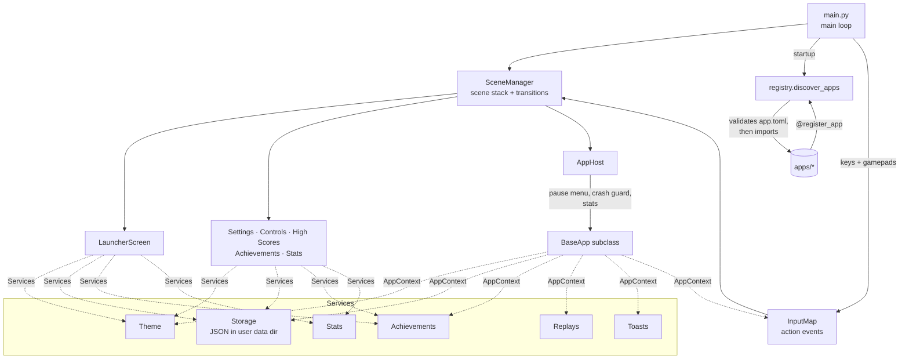

# Arcade

An all-in-one desktop arcade of small games and tools, built with Python and [pygame-ce](https://pyga.me/).
One window, one main loop, a launcher to pick from, and a plugin system that makes adding a new app
as simple as dropping a folder into `apps/`.


## Features

- **Plugin architecture**: each app is a folder in `apps/` with an `app.toml` manifest. Apps are validated and discovered at startup; adding one never touches the launcher.
- **Launcher**: Favorites and Recently played rows, a card grid with category tabs (All / Games / Tools), search-as-you-type, and full keyboard and gamepad navigation.
- **Achievements**: every game has a few, unlocked with a toast and listed on an Achievements screen.
- **Stats**: play time, sessions and last played per app, tracked automatically, with a Stats screen.
- **Daily challenge**: a date-seeded puzzle that is the same for everyone each day (Sudoku first; reusable by any app).
- **Replays**: Snake and Star Siege record your best run (seed + inputs) so you can watch it back.
- **Remappable controls and gamepads**: shared actions (move, action, pause) that every app reads; rebind keys in Settings → Controls; plug-and-play gamepads.
- **Framework-level pause menu** (Esc or Start → Resume / Restart / Back to menu). Games also pause automatically when the window loses focus.
- **Crash isolation**: if an app throws, the error is logged and a friendly dialog brings you back to the launcher.
- **Global High Scores** screen, generated from every app that tracks scores (including per-difficulty bests).
- **Settings**: dark/light theme, window size presets, fullscreen (F11), animations, controls and a developer mode (debug overlay, F5 hot reload).
- **Screenshots**: F12 saves a PNG to the data folder.
- **Modern look**: flat design, rounded corners, soft shadows, hover/press states and screen transitions; all graphics are drawn in code and rendered at native resolution (sharp on Retina displays).
- **Quality**: type hints throughout, `mypy --strict`, `ruff`, ~500 pytest tests, GitHub Actions CI.

### Apps

31 apps (28 games and 3 tools), each one a self-contained package in `apps/`.
The arcade-genre games (Stackfall, Brick Blitz, Paddle Duel, Skyhop, Star Siege, Void Drift, Firefly,
Crate Keeper, Echo Pads, Updraft, Rooftop Dash, Four in a Row, Five Letters) are original takes on classic genres, with their own names, art and tuning.

**Games**

| App | Highlights |
|-----|------------|
| **2048** | Animated slides, merges and spawns; keyboard or mouse swipe; resume an unfinished game |
| **Brick Blitz** | Four hand-made layouts, multi-hit and steel bricks, paddle-angle control, keyboard or mouse, sub-stepped collisions |
| **Checkers** | English draughts: compulsory captures, multi-jumps chosen hop by hop, crowning, 40-move draw; animated jumps; alpha-beta computer in 3 levels; resumes your game |
| **Chess** | Full rules (castling, en passant, promotion, checkmate, stalemate, fifty-move, threefold repetition, insufficient material), verified with perft; legal-move highlights, drag or click, notation history, undo, flip; alpha-beta engine in 3 levels on a background thread; resumes your game |
| **Crate Keeper** | Crate-pushing puzzles: 15 original levels loaded from JSON files (each proven solvable by a solver in the tests), unlock as you go, undo, restart, best moves per level |
| **Echo Pads** | Memory pattern game: four pads in a plus so the arrows map onto them; Classic grows the pattern by one, Shuffle draws a new one each round; playback speeds up as it grows; the missed pad is ringed |
| **Firefly** | Maze chase in a night garden: four shades with their own hunting styles (stalker, ambusher, flanker, wanderer), scatter/chase phases, lanterns that turn the tables, levels that speed up |
| **Five Letters** | Word guessing: 800 hand-picked answers, 8.5k valid guesses, duplicate-aware scoring, hard mode, stats and best streak |
| **Four in a Row** | Negamax with alpha-beta (up to 7 moves deep) on a background thread, 3 levels, falling-disc animation |
| **Hangman** | Six bundled categories (phrases too), type or click letters, hints that cost a miss, chalkboard drawing, missed letters revealed on a loss, win streaks |
| **Memory Match** | 3 board sizes, 12 vector symbols, flip animations, moves counter, best time per size |
| **Minesweeper** | 3 board sizes, first click always safe (and opens an area), flags, chording, best time per size |
| **Nonogram** | Picture logic puzzles: 8 bundled pictures (names hidden until solved) and a random generator, all verified uniquely solvable by a line-logic solver; drag to paint, cross out cells, completed clues fade, colour reveal |
| **Paddle Duel** | 2 players on one keyboard, or a CPU that predicts bounces (3 levels, simulation-tested); spin; longest-rally record |
| **Reaction Test** | Classic: wait for green, five rounds averaged, false starts repeat the round; Targets: 15 mouse targets that always jump away; timed from input timestamps, not frames; bests in ms |
| **Rooftop Dash** | Endless runner over a parallax skyline: variable-height jumps with coyote time and buffering, slides, crates, drones, coins; speed is a function of distance so every gap and obstacle is generated clearable (a bot test runs 150 s on every seed) |
| **Skyhop** | One-button flyer through neon gates, parallax skyline, capped difficulty ramp |
| **Sliding Tiles** | The 8 and 15 puzzles: shuffles checked with the inversion-parity test, multi-tile slides, gliding animation, best time per size |
| **Snake** | Queued turns, speeds up as you eat, walls or wrap-around, smooth interpolated movement |
| **Stackfall** | Falling blocks: 7-bag randomizer, wall kicks, lock delay, ghost piece, hold, 5-piece preview |
| **Solitaire** | Klondike with drag and drop, double/right-click to send home, draw 1 or 3, unlimited undo, one-click finish, keyboard play; vector-drawn cards |
| **Star Siege** | Fixed-screen shooter: formations speed up as they thin out, eroding shields, lives, waves |
| **Sudoku** | Unique-solution generator (Easy/Medium/Hard), pencil notes, conflict highlighting, check, undo, resume |
| **Switchboard** | Lights puzzle on 4×4, 5×5 or 6×6 boards: always-solvable shuffles, a GF(2) solver for par and hints, undo and restart |
| **Tic-tac-toe** | Unbeatable minimax (exhaustively tested) or an easy mode; win/draw/loss record |
| **Typing Test** | 15, 30 or 60 second tests from a bundled list of common words: live WPM and accuracy, mistakes and extra letters shown in place, backspace into mistyped words, results card with raw WPM and a speed chart, best per length |
| **Updraft** | Endless vertical climber: auto-bounce and steer, wrap-around sides, solid, moving, crumbling and spring platforms; gaps always within jump height (a bot test climbs every seed); dusk-to-night sky |
| **Void Drift** | Wrap-around space shooter: thrust and inertia, rocks that split in three sizes, weaving drones that shoot back, warp escape, waves and extra lives |

**Tools**

| App | Highlights |
|-----|------------|
| **Calculator** | Hand-written recursive-descent parser (no `eval`), precedence, parentheses, powers, exact decimals, history |
| **Focus Timer** | Pomodoro cycles and a lap stopwatch; wall-clock based so it keeps running while you play; visual alerts (no sound) |
| **Unit Converter** | 8 categories with exact `Decimal` factors, every unit shown at once |

## Screenshots

> _Screenshots and GIFs coming soon._

| Launcher | Sudoku | Star Siege |
|----------|--------|------------|
|  |  |  |

## Getting started

Requires **Python 3.11+**.

```bash
git clone https://github.com/OWNER/arcade-app.git
cd arcade-app
python -m venv .venv
source .venv/bin/activate          # Windows: .venv\Scripts\activate
pip install -r requirements.txt
python main.py
```

### Controls

| Where      | Keys |
|------------|------|
| Everywhere | **Esc** pause menu / back · **F11** fullscreen · **F12** screenshot · **F5** reload the current app (developer mode) |
| Launcher   | **Arrows** select · **Enter** open · **Ctrl+D** favorite · **Tab** switch category · just start typing to search |
| 2048       | **Arrows/WASD** or drag with the mouse · **N** new |
| Brick Blitz | **←/→** or mouse to move · **Space** / click to launch |
| Calculator | Type the expression · **Enter** evaluate · **Backspace** delete · **Del** clear · **^** power |
| Checkers   | Click a piece, then each landing square · **arrows** + **Space** · **U** undo |
| Chess      | Click or drag a piece, then a highlighted square · **arrows** + **Space** · **U** undo · **F** flip board |
| Crate Keeper | **Arrows/WASD** walk and push · **U**/**Backspace** undo · **R** restart · **Esc** level list |
| Echo Pads  | **Arrows** or click the pads · **Space** start
| Firefly    | **Arrows/WASD** steer (turns are remembered until the next junction) |
| Five Letters | Type letters · **Enter** submit · **Backspace** delete (or use the on-screen keyboard) |
| Focus Timer | **Space** start/pause · **R** reset · **S** skip · **L** lap · **Tab** switch |
| Four in a Row | Click a column or **1–7** · **←/→** + **Enter** · **N** new round |
| Hangman    | Type or click letters · **?** hint · **Enter** next word |
| Memory Match | Click a card, or **arrows** + **Space** · **N** new game |
| Minesweeper | **Left click** reveal · **Right click** flag · click a number to chord · **Arrows** + **Space** / **F** · **N** new |
| Nonogram   | **Left click** fill · **right click** cross · drag to paint · **arrows** + **Space** / **X** · **U** undo |
| Paddle Duel | Left **W/S** · right **↑/↓** (vs CPU: either set) |
| Reaction Test | Click or **Space** when it turns green · Targets: click with the mouse |
| Rooftop Dash | **Space**/**↑**/click jump (hold for height) · **↓** slide, or drop faster in the air |
| Skyhop     | **Space**, **↑** or click to hop |
| Sliding Tiles | Click a tile in the gap's row or column · **arrows** slide a tile into the gap · **U** undo |
| Snake      | **Arrows/WASD** steer · **P** pause · **R** watch your best run (on the start card) |
| Stackfall  | **←/→** move · **↓** soft drop · **↑/X** rotate · **Z** rotate back · **Space** hard drop · **C** hold · **P** pause |
| Solitaire  | Drag cards · double/right-click sends a card home · **D** draw · **U**/**Ctrl+Z** undo · **F** send home · **A** finish · **N** new · keyboard: **arrows** choose, **Space** pick up/put down |
| Star Siege | **←/→** or **A/D** move · **Space** fire (hold to auto-fire) · **R** watch your best run |
| Sudoku     | **Arrows/WASD** move · **1–9** place · **0/Backspace** erase · **P** notes · **U** or **Ctrl+Z** undo · **C** check · **N** new |
| Switchboard | Click a light, or **arrows** + **Space** · **H** hint · **U** undo · **N** new puzzle |
| Tic-tac-toe | Click or **1–9** · **Arrows** + **Enter** · **N** new round |
| Typing Test | Type · **Space** next word · **Backspace** (with **Ctrl/Alt/⌘**: whole word) · **Tab** restart |
| Updraft    | **←/→** or **A/D** steer · **Space** start |
| Void Drift | **←/→** turn · **↑** thrust · **Space** fire (hold to auto-fire) · **↓** warp |
| Unit Converter | Type a value · **↑/↓** category · **←/→** unit · click a result to convert from it |

These are the default keys. Arrows/WASD, Space/Enter and Esc are the shared **actions** (up, down,
left, right, action, pause) and can be rebound in **Settings → Controls**. A connected **gamepad**
works everywhere: D-pad or left stick to move, **A** to confirm, **B**/**Start** to pause or go back.
App-specific shortcuts (like **N** for a new game) and typing keep their fixed keys.

### Development

```bash
pip install -r requirements-dev.txt
ruff check .            # lint
ruff format .           # format
mypy                    # type check (strict)
pytest                  # tests run headless (SDL dummy video driver)
```

Saves, settings and the log file live in a per-user folder:
`~/Library/Application Support/Arcade` (macOS), `%APPDATA%\Arcade` (Windows) or `~/.local/share/arcade` (Linux).
Set `ARCADE_DATA_DIR` to use a different folder.

## Architecture



**How the plugin system works**

1. Every app is a package in `apps/` with an **`app.toml` manifest** and an `__init__.py` that imports a class decorated with `@register_app`.
2. At startup `discover_apps()` walks `apps/`. For each package it first reads and validates the manifest (`core/manifest.py`): required fields, types, ids, colors, and `min_framework` against `FRAMEWORK_VERSION`. A missing or invalid manifest, or one that needs a newer framework, skips the package **without running its code**; the problem is logged and the launcher shows a warning. Then the package is imported and the decorator registers the class, which gets its `AppMeta` from the manifest. Packages starting with `_` (such as `_template`) are skipped.
3. The launcher builds its cards from each app's metadata and its `draw_icon()`.
4. Opening an app pushes an `AppHost` scene that owns the framework behaviour: the pause menu, auto-pause on focus loss, restart, return to launcher, play-time stats, and catching any exception from the app.
5. Apps only talk to the framework through `AppContext` and the helpers on `BaseApp` (`submit_score`, `best_score`, `data`, `unlock`, `input`, `daily`), so they never import launcher or screen code.

**Framework services**

- **Input mapping** (`core/input.py`, `core/gamepad.py`): the main loop turns bound keys and gamepad input into `ACTIONDOWN`/`ACTIONUP` events for six shared actions, and tracks held state (`self.input.held("left")`). Apps check `is_action(event, "left")` instead of specific keys. Scenes that take typed text get no actions from printable keys, and Ctrl/Cmd/Alt combinations are left as shortcuts. Bindings are saved to `input.json`.
- **Achievements** (`core/achievements.py`): declared in each manifest, unlocked with `self.unlock(id)` or `self.unlock_milestones(value, {...})`, saved to `achievements.json` and announced with a toast.
- **Stats** (`core/stats.py`): `AppHost` records sessions, play time (not while paused) and last played in `stats.json`.
- **Daily challenge** (`core/daily.py`): `self.daily.rng()` is seeded from a SHA-256 of the app id and the date, so everyone gets the same puzzle; `self.daily.record(...)` stores each day's result and a streak.
- **Replays** (`core/replay.py`): a game whose logic uses one seeded RNG and runs on a `FixedStep` timestep records timestamped input commands with a `Recorder`; a `Player` feeds them back step by step. `ReplayStore` keeps the best run per app and variant.
- **Toasts** (`core/toasts.py`), **screenshots** (`core/screenshots.py`) and **developer tools** (`core/devtools.py`: debug overlay, and F5 hot reload through `AppRegistry.reload`).

**Other design decisions**

- **Logical canvas, native pixels.** Apps lay everything out on a fixed 1280×720 canvas, but `core.canvas.Canvas` rasterises shapes and text at the window's real resolution (2× on Retina, any factor when resized), so nothing is drawn small and stretched into blur. `core.gfx` mirrors `pygame.draw` in logical units, fonts measure in logical pixels, and mouse events are mapped back, so game code never deals with window sizes or pixel density.
- **Logic is separate from drawing.** Each app has a `logic.py` with no pygame import, which holds the rules and is unit-tested directly. `app.py` only translates input and draws.
- **Storage** is plain JSON with atomic writes (temp file + rename). Corrupt files are logged and treated as empty, never fatal.
- **Theme tokens** (`theme.palette.surface`, `theme.space.md`, `theme.radius.lg`...) instead of hard-coded colors, so the light theme works everywhere.

### Project structure

```
main.py                 entry point and main loop
core/
  base_app.py           BaseApp, AppMeta, AppContext: the app contract
  manifest.py           app.toml parsing, validation and FRAMEWORK_VERSION
  registry.py           @register_app, auto-discovery and hot reload
  app_host.py           runs an app: pause menu, restart, stats, crash isolation
  scene_manager.py      scene stack with fade/slide transitions
  services.py           the shared services bundle
  input.py, gamepad.py  remappable actions, keyboard and gamepad
  achievements.py       achievement definitions and unlocks
  stats.py              play time, sessions, last played
  daily.py              date-seeded daily challenges
  replay.py             record and play back runs
  favorites.py          launcher favorites
  toasts.py             notification toasts
  screenshots.py        F12 screenshots
  devtools.py           developer overlay and hot reload
  display.py            window, high-DPI letterboxing, fullscreen, mouse mapping
  canvas.py, gfx.py     resolution-independent Canvas, Font and pygame.draw equivalents
  theme.py, draw.py     design tokens and drawing helpers (shadows, rounded rects, text, icons)
  storage.py            JSON saves: high scores, settings, per-app data
  settings.py           typed user settings
  widgets/              Button, Card, Label, Grid, Toggle, TextInput, SegmentedControl, ButtonMenu...
screens/                launcher, settings, controls, high scores, achievements, stats
apps/
  _template/            minimal app to copy
  calculator/  focus_timer/  unit_converter/                    tools
  brick_blitz/  checkers/  chess/  crate_keeper/  echo_pads/  firefly/  five_letters/  four_in_a_row/  hangman/  memory_match/      games
  minesweeper/  nonogram/  paddle_duel/  reaction_test/  rooftop_dash/  skyhop/  sliding_tiles/  snake/  solitaire/
  stackfall/  switchboard/
  star_siege/  sudoku/  tictactoe/  twenty48/  typing_test/  updraft/  void_drift/
assets/fonts/           Inter (SIL Open Font License)
tests/                  pytest suite (headless)
```

## How to add a new app

The `apps/_template` package is a complete, working app (a click counter with a saved high score
and one achievement). To create your own:

1. **Copy the template.** Use a folder name without a leading underscore, or it will be hidden:
   ```bash
   cp -r apps/_template apps/my_game
   ```
2. **Fix the imports** in `apps/my_game/__init__.py` and `app.py` (`apps._template` → `apps.my_game`), and rename `TemplateApp`.
3. **Describe your app in `app.toml`.** This is the only place for its metadata:
   ```toml
   id = "my_game"               # unique and stable: it's the save-file key
   name = "My Game"
   description = "One line for the launcher card."
   category = "game"            # or "tool"
   accent = "#FF7850"
   version = "1.0.0"
   author = "Arcade contributors"
   min_framework = "1.0"        # oldest framework version your app works with

   [scores]                     # optional: show on the High Scores screen
   order = "higher"             # "lower" for times
   format = "points"            # or "time" (m:ss) or "ms"
   variants = ["easy", "hard"]  # optional per-variant bests

   [[achievements]]             # optional, repeatable (games should have 2-4)
   id = "score_100"
   name = "Centurion"
   description = "Score 100 points."
   ```
   If the manifest is invalid, the launcher skips the app and `arcade.log` says exactly what is wrong.
4. **Write the rules** in `logic.py` without importing pygame, so you can test them.
5. **Implement the hooks** in `app.py`:
   - `on_enter()`: build or reset state (also called on Restart)
   - `handle_event(event)`, `update(dt)`, `draw(surface)`
   - optional: `on_exit()`, `on_pause()`, `on_resume()`, `captures_pause()`, `uses_text_input()`, `draw_icon()`
6. **Read the shared controls, not keys.** Use `is_action(event, "left")`, `direction(event)` or `action_of(event)` from `core.input` for movement, confirm and pause, and `self.input.held("left")` for continuous movement. Keep raw `pygame.KEYDOWN` only for app-specific shortcuts. If your app takes typed text, return `True` from `uses_text_input()`. Show keys in hints with `self.input.label("action")` so they stay right after rebinding.
7. **Draw** with `core.gfx` (same functions and arguments as `pygame.draw`) and `core.draw` helpers, in 1280×720 logical coordinates. Make offscreen layers with `Canvas.new(size, alpha=True)` instead of `pygame.Surface`, and read the mouse with `core.canvas.mouse_pos()`.
8. **Use the shared pieces**: `self.theme` for colors and fonts, `core.widgets` for UI, `self.submit_score(score, variant)` for high scores, `self.unlock("score_100")` or `self.unlock_milestones(score, {"score_100": 100})` for achievements, `self.daily` for a daily mode, `core.replay` for replays, and `self.data` (call `self.data.save()`) for anything else you want to persist.
9. **Run it.** `python main.py` shows your app in the launcher. No other file needs to change. Turn on developer mode in Settings to reload your app with **F5** while you work on it.
10. **Test it.** `tests/test_apps_smoke.py` automatically runs every discovered app headless with random input (also at 1.5× and 2× scale) and checks that every achievement you unlock is declared. Add a `tests/test_my_game.py` for your logic; the `tap`/`hold`/`feed` helpers in `tests/conftest.py` send keys through the same action mapping as the real main loop.

Tip: run `ARCADE_SHOW_TEMPLATE=1 python main.py` to see the template itself in the launcher.

## License

[MIT](LICENSE). The bundled [Inter](https://rsms.me/inter/) font is licensed under the
[SIL Open Font License 1.1](assets/fonts/OFL.txt). Five Letters' guess list comes from Webster's Second
International Dictionary (1934, public domain), as distributed with BSD systems.
